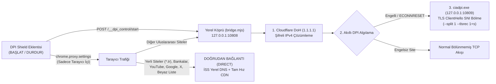

# ⚡ DPI Shield — Tarayıcı İçi Akıllı DoH & DPI Engel Aşıcı Eklentisi


-Yok%20(User--Space)-success)


**DPI Shield**, Windows'un genel ağ ve proxy ayarlarına müdahale etmeden, **yalnızca eklentiyi yüklediğiniz tarayıcı içinde** çalışan; tek tıkla **BAŞLAT / DURDUR** yapılabilen sürücüsüz (**User-Space**) bir **DNS-over-HTTPS (DoH) + DPI (SNI Paket Bölme)** engel aşma çözümüdür.

---

## 🌟 Neden DPI Shield?

| Özellik | Klasik VPN'ler | GoodbyeDPI (`WinDivert`) | **⚡ DPI Shield (Bu Proje)** |
| :--- | :---: | :---: | :---: |
| **Çalışma Kapsamı** | Tüm PC | Tüm PC (Kernel Sürücüsü) | **Sadece Yüklü Olduğu Tarayıcı** |
| **İndirme Hızı & Ping** | Düşer (Yurt dışı sunucu) | Tam Hız | **Tam Hız (Aracı sunucu yok)** |
| **Yönetici İzni / Sürücü** | Gerekli (TUN/TAP) | Gerekli (`WinDivert64.sys`) | **Gerekmez ( %100 User-Space )** |
| **Oyun / Anti-Cheat Uyumu** | Ping yapar | Vanguard / EAC ile çakışabilir | **%100 Uyumlu (Sürücüsüz)** |
| **Aç / Kapa Kontrolü** | Uygulama penceresi | Servis / `.bat` dosyası | **Tarayıcı İçi Tek Tık Eklenti** |

---

## 🛠️ Kurulum Rehberi (Adım Adım)

Projeyi bilgisayarınızda istediğiniz herhangi bir klasöre (örneğin `C:\DPI-Shield` veya `D:\DPI-Shield`) indirip çıkarın. Klasörü sildiğinizde eklenti devre dışı kalacağı için **kalıcı durmasını istediğiniz bir klasöre** çıkartmanız önerilir.

### 📋 Ön Koşul
* Bilgisayarınızda **[Node.js](https://nodejs.org/)** (LTS sürümü) kurulu olmalıdır.

---

### 1️⃣ Adım: Yerel Arka Plan Motorunu Kurun
Tarayıcı eklentileri güvenlik kısıtlamaları (sandbox) nedeniyle doğrudan TCP paketlerini parçalayamaz. Bu yüzden eklentinin verdiğiniz **Başlat / Durdur** komutlarını dinleyecek hafif yerel köprüyü kurun:

1. İndirdiğiniz klasörün içindeki **`1_Arka_Plan_Servisini_Kur.bat`** dosyasına çift tıklayın *(Yönetici izni gerektirmez)*.
2. `"YEREL MOTOR HAZIR!"` mesajını gördüğünüzde pencereyi kapatabilirsiniz.
   > 💡 **Not:** Bu servis Windows'un genel proxy ayarlarına **dokunmaz** ve siz eklentiden **BAŞLAT** diyene kadar DPI motorunu (`ciadpi.exe`) çalıştırmaz.

---

### 2️⃣ Adım: `DPI-Shield-Extension` Klasörünü Tarayıcınıza Ekleyin

Eklentiyi **Opera**, **Opera GX**, **Google Chrome**, **Brave** veya **Microsoft Edge** tarayıcınıza yüklemek için:

1. Tarayıcınızın adres çubuğuna aşağıdaki adresi yazıp `Enter`'a basın:
   * **Opera / Opera GX:** `opera://extensions`
   * **Chrome:** `chrome://extensions`
   * **Brave:** `brave://extensions`
   * **Edge:** `edge://extensions`
2. Sayfanın sağ üst köşesinde bulunan **Geliştirici modu (Developer mode)** anahtarını **Açık** konuma getirin.
3. Sol üstte beliren **Paketlenmemiş öğe yükle (Load unpacked)** butonuna tıklayın.
4. Açılan dosya seçme penceresinden, indirdiğiniz klasörün içindeki **`DPI-Shield-Extension`** klasörünü seçin ve **Klasörü Seç** butonuna basın.
5. Tarayıcınızın sağ üst köşesindeki **Eklentiler (Yapboz / Küp)** simgesine tıklayıp **DPI Shield** eklentisinin yanındaki **Sabitle (İğne)** simgesine tıklayın.

---

## 🚀 Kullanım

1. **Engel Aşmayı Başlatma:**
   Tarayıcı araç çubuğundaki **⚡ DPI Shield** simgesine tıklayın ve yeşil **BAŞLAT** butonuna basın.
   * İkon üzerinde yeşil **`ON`** rozeti belirecek ve sadece o tarayıcı içinde şifreli DNS (DoH) + DPI paket bölme aktif olacaktır.
2. **Engel Aşmayı Durdurma:**
   Eklenti penceresindeki kırmızı **DURDUR** butonuna bastığınız anda arka plandaki `ciadpi.exe` işlemi sonlandırılır, tarayıcı proxy ayarı temizlenir ve ikon **`OFF`** durumuna geçer.
3. **Site Hariç Tutma (Beyaz Liste / `DIRECT`):**
   * Eklenti açıkken Türkiye uzantılı siteler (`*.tr`), bankalar, e-Devlet ve büyük yerel CDN servisleri (`YouTube`, `Google`, `Netflix`, `Steam`, `X/Twitter` vb.) zaten otomatik olarak doğrudan (**`DIRECT`**) bağlanır.
   * Herhangi bir sitedeyken eklenti penceresini açıp **"+ Doğrudan Bağlan (Hariç Tut)"** butonuna basarak o siteyi tek tıkla beyaz listeye ekleyebilir veya listeden çıkarabilirsiniz.

---

## 🧠 Teknik Çalışma Mantığı



1. **İzole Tarayıcı Yönlendirmesi (`chrome.proxy.settings`):**
   Windows'un sistem proxy ayarlarını değiştirmek yerine yalnızca Chromium'un eklenti API'sini kullanır. Böylece bilgisayardaki diğer uygulamalar ve oyunlar etkilenmez.
2. **Şifreli DNS Çözümleme (DoH):**
   İSS'nin DNS engellerini aşmak için alan adları `https://1.1.1.1/dns-query` üzerinden TLS 1.3 ile şifreli olarak çözülür ve RAM'de önbelleğe alınır.
3. **Sürücüsüz TLS Kayıt Bölme (`--split 1 --tlsrec 1+s`):**
   İSS'lerin DPI cihazları HTTPS bağlantılarının ilk paketi olan `TLS ClientHello` içindeki açık metin **SNI (site adı)** alanını okuyarak bağlantıyı sıfırlar (`TCP RST`). Yerel motor, bu ilk paketi tam SNI uzantısının ortasından iki geçerli TLS kaydına bölerek gönderir; DPI cihazı tam alan adını göremediği için bağlantı kesilmez.
4. **Şeffaf Yeniden Oynatma (Auto-Learning Failover):**
   Bilinmeyen yabancı bir siteye bağlanırken sunucu uyumluluğunu korumak için önce normal bağlantı denenir. Eğer İSS DPI cihazı bağlantıyı sıfırlarsa (`ECONNRESET`), köprü tarayıcıya hata yansıtmadan bellekteki `ClientHello` paketini milisaniyeler içinde bölerek tekrar gönderir ve siteyi otomatik öğrenir.

---

## 🗑️ Kaldırma

Sistemi tamamen kaldırmak isterseniz:
1. Tarayıcınızdan **DPI Shield** eklentisini kaldırın.
2. Klasör içindeki **`2_Arka_Plan_Servisini_Kaldir.bat`** dosyasına çift tıklayın.

---

## 📂 Proje Klasör Yapısı

```text
├── README.md                          # Kurulum ve teknik mimari rehberi
├── 1_Arka_Plan_Servisini_Kur.bat      # Yerel dinleyici servisini kuran betik
├── 2_Arka_Plan_Servisini_Kaldir.bat   # Yerel dinleyici servisini kaldıran betik
├── DPI-Shield-Extension/              # Tarayıcıya (Geliştirici Modu ile) yüklenecek eklenti klasörü
│   ├── manifest.json
│   ├── background.js
│   ├── popup.html
│   ├── popup.css
│   ├── popup.js
│   └── icon.png
└── dosyalar/                          # Yerel motor dosyaları
    ├── bridge.mjs                     # Akıllı DoH + Otomatik Failover Node.js sunucusu
    ├── ciadpi.exe                     # ByeDPI (x86_64) yerel Winsock paket bölücü
    └── start_invisible.vbs            # Penceresiz arka plan başlatıcı
```

---

## 📜 Lisans
* Paket bölme katmanı açık kaynaklı [hufrea/byedpi](https://github.com/hufrea/byedpi) (`LGPL-3.0`) projesinin `ciadpi` ikili dosyasını kullanır.
* Tarayıcı eklentisi (`DPI-Shield-Extension`) ve akıllı DoH köprüsü (`bridge.mjs`) MIT Lisansı altında sunulmuştur.
